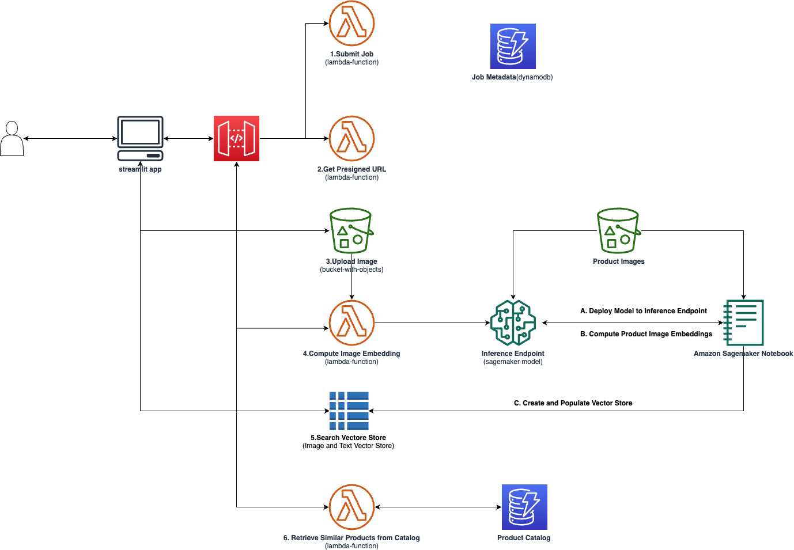
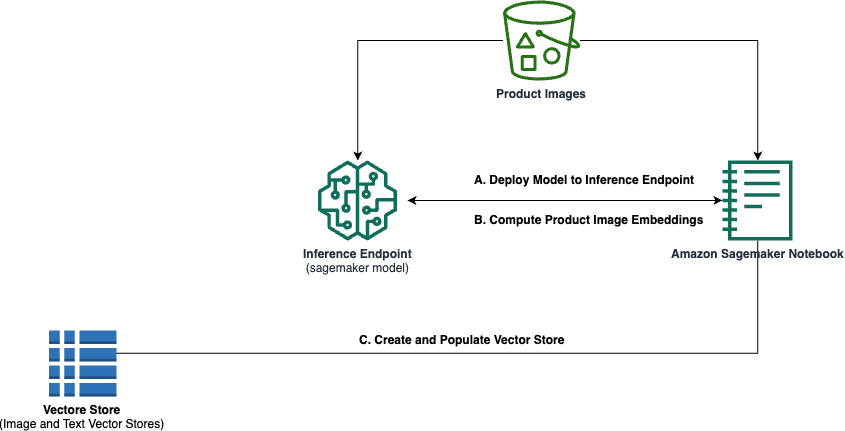
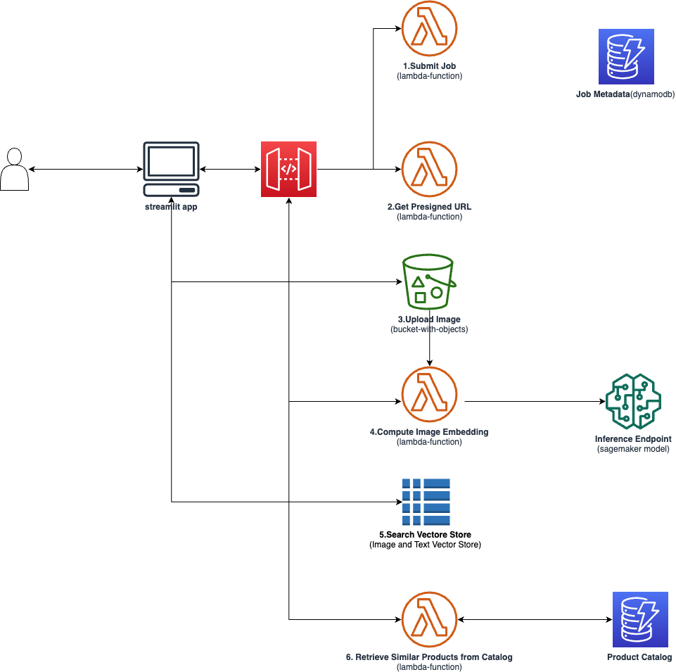

# Enabling Visual Search for Ecommerce with CLIP and Amazon SageMaker
## How to build visual search for your online store using multi-modal models and vector similarity search

### Introduction 
- Explain the value of visual search for ecommerce - allowing customers to find products using image queries rather than just text search.
- Include data points on influence of visual search
- Overview of the architecture using SageMaker, Faiss, API Gateway, etc.
Visual search is becoming an increasingly valuable capability for ecommerce companies to better serve their customers. By allowing shoppers to find products using image queries rather than just text search, visual search provides a more intuitive and user-friendly experience. According to Gartner, early adopter brands that redesign their websites to support visual and voice search will increase digital commerce revenue by 30%. Implementing visual search can lead to higher customer engagement, reduced returns, and increased sales. 

In this post, you will walk through building visual search for an online store using multi-modal machine learning models and vector similarity search. The architecture consists of several components working together: Amazon SageMaker to host the multi-modal model, Faiss to create vector databases for efficient similarity search, API Gateway and Lambda to handle request routing and processing, and DynamoDB to store metadata. 

We will use the CLIP model from OpenAI which has been pretrained to generate joint embeddings for images and text that capture semantic similarity. By indexing product images and text in a vector database using CLIP embeddings, we can find visually similar products by querying with a product image. The dataset used is [Flipkart Products](https://www.kaggle.com/datasets/PromptCloudHQ/flipkart-products) a pre-crawled dataset, taken as subset of a bigger dataset (more than 5.8 million products) that was created by extracting data from Flipkart.com.

By the end of the post, you'll understand how to construct an end-to-end architecture using SageMaker, Faiss, API Gateway, Lambda, and other services to deliver visual search for ecommerce. This technique can enhance product discovery and shopping experiences across retail sites and apps. 



Let's get started!

### On Embeddings in Search with Vector Stores
- V

### Setting Up CLIP Inference on SageMaker
- Briefly introduce CLIP and how it can enable visual search by creating joint embeddings for images and text.
- Step-by-step walkthrough of deploying CLIP inference endpoint on SageMaker using the Inference Toolkit.
- Explain the purpose of the inference endpoint and how it will be used.

CLIP (Contrastive Language-Image Pretraining) is a neural network model developed by OpenAI that has been pre-trained on a variety of (image, text) pairs from the internet. It excels at finding semantic similarities between images and text descriptions. 

CLIP creates a joint embedding space for images and text, meaning it can encode both modalities into the same high-dimensional vector representation. Images and texts with similar meaning will have closer embeddings in this space. This makes CLIP ideal for visual search, as we can embed product images and descriptions into a common vector space and find similarities.

To leverage CLIP for our visual search system, we will deploy it as an inference endpoint on SageMaker. 

Firstly, since we want the inference results to be computed embeddings, we use the [SageMaker Inference Toolkit](https://docs.aws.amazon.com/sagemaker/latest/dg/adapt-inference-container.html) to creat a custom inference handler script to handle requests and responses to/from the model. For example we define a predict_fn function that takes an inference request body and content type as input and computes embeddings of the request body using our model:
```python
def predict_fn(request_content_type_and_input_object, model_and_processor):
    model, processor = model_and_processor
    request_content_type, input_object = request_content_type_and_input_object
    
    def chunk_and_process_text(text):
        text_chunks = chunk_text(text, processor)
        features_sum, count = None, 0
        
        for text_chunk in text_chunks:
            inputs = processor(text=text_chunk, padding=True, return_tensors="pt").to(device)
            try:
                features = model.get_text_features(**inputs)
                if features_sum is None:
                    features_sum = torch.zeros_like(features).to(device)
                features_sum += features
                count += 1
            except RuntimeError as e:
                logger.error(f"Text chunk '{text_chunk}' of length {len(text_chunk)} caused an error: {e}")

        return (features_sum / count).detach()
```

We package the CLIP model along with the inference handler script in a model.tar.gz and copy to an Amazon S3 bucket location for deployment to a sagemaker inference endpoint.

We then deploy our model, here is sample code of the deployment
```python
from sagemaker.huggingface.model import HuggingFaceModel

# create Hugging Face Model Class
huggingface_model = HuggingFaceModel(
    model_data=s3_location,       # path to your model and script
    role="arn:aws:iam::ACCOUNT_ID:role/service-role/AmazonSageMaker-ExecutionRole-EXAMPLE",
    transformers_version="4.26.0",  # transformers version used
    pytorch_version="1.13.1",        # pytorch version used
    py_version='py39', # python version used
    sagemaker_session = sagesess
)

# deploy the endpoint 
clip_model = huggingface_model.deploy(
    initial_instance_count=1,
    instance_type="ml.g4dn.xlarge",
    endpoint_name="clip-model",
    )
```

Now we have a hosted CLIP inference endpoint on SageMaker that can accept image and text inputs and return embeddings for each. We can integrate this into our overall architecture by having our Lambda functions send requests during ingestion and search. The embeddings will populate our Faiss vector stores.

### Building Product Image and Text Vector Stores with Faiss
- Using in memory, can use opensearch, pgvector postgres any other
- Explain how Faiss library allows efficient similarity search on vectors.
- Walk through process of indexing product images and text in Faiss using CLIP endpoint.

Now that we have our CLIP inference endpoint deployed on SageMaker, we can use it to embed our product catalog images and text into a numerical vector space. To enable ultra-fast similarity search on these embeddings, we will build vector databases using Faiss.

Faiss enables ultra-fast similarity search on vector embeddings, making it ideal for powering visual search on our CLIP image and text embeddings. 

#### Overview of Faiss

Faiss is an open source library developed by Facebook AI Research for efficient similarity search and clustering of dense vectors. Some key features:

- Optimized data structures like inverted indices for rapid nearest neighbor search.
- Support for GPU acceleration for high throughput ingestion and low latency queries.  
- Flexible indexing options - flat, hierarchical, IVF (inverted file).

By using Faiss to index the CLIP embeddings for our product catalog, we gain sub-second response times for similarity search queries.

#### Indexing Process

To build our Faiss indices:

1. Fetch product images and descriptions from our catalog database.

2. Pass each image through the SageMaker CLIP endpoint to generate an image embedding vector.

3. Pass each product's title and description through CLIP to get a text embedding. 

4. Add the image and text embedding vectors to their respective Faiss indices. 

5. Store the index position to product ID mapping for retrieval.

This gives us two vector databases - one for visual similarity based on product images, and one for semantic similarity based on product text.

#### Implementation Details
We will define our functions to send inference requests to our inference endpoint to compute embeddings:

```python
def get_image_embedding(image_info, clip_model):
    clip_model.serializer = IdentitySerializer(content_type="application/x-image")
    clip_model.deserializer = JSONDeserializer()
    return  clip_model.predict(
        data=image_info
    )
def get_text_embedding(text, clip_model):
    clip_model.serializer = JSONSerializer()
    clip_model.deserializer = JSONDeserializer()
    return clip_model.predict({
        "inputs":
            text
        
    })
```

To allow  multi-threaded ingestion into Faiss, we:

- Split the product catalog into chunks for multi-threaded processing.
```python
NUM_PROCESSES = 400
items_chunks = split_data(items, NUM_PROCESSES)
```
- Generate partial indices per chunk using CLIP.
```python
def process_records_partial(items_chunk):
    
    initialise_clip_model()
    initialise_bedrock()
    initialise_s3()
    
    local_image_embeddings = []
    local_text_embeddings = []
    local_image_id_to_record = {}
    local_text_id_to_record = {}
    image_idx = 0
    idx = 0
    
    for item in tqdm(items_chunk):
        product_id, image_url_list, description = process_item(item)
        
        image_embedding_count = 0
        for image in image_url_list:
            #here we fetch our product images
            image_response = fetch_image(image)
            if not image_response[1]:
                continue
            try:
                image_content = image_response[0]
                #send each image as an inference request to our endpoint to compute image embedding
                local_image_embeddings.append(normalise_embedding(np.array(get_image_embedding(image_content, clip_model)).astype('float32')))
                image_embedding_count += 1
            except Exception as e:
                pass

            #Store the image embedding index position to product ID mapping for retrieval
            local_image_id_to_record[image_idx] = product_id
            image_idx += 1

        if image_embedding_count == 0:
            continue

        try:
            #send the product description as an inference request to our endpoint to compute text embedding
            text_embedding_flt = np.array(get_text_embedding(clean_and_prepare_text(description), clip_model)).astype('float32')
            local_text_embeddings.append(normalise_embedding(text_embedding_flt))
            #Store the text embedding index position to product ID mapping for retrieval
            local_text_id_to_record[idx] = product_id
            idx += 1
        except Exception as e:
            continue

    return local_image_embeddings, local_text_embeddings, local_image_id_to_record, local_text_id_to_record

```
- Merge the partial indices into the final Faiss stores.
```python
with ThreadPoolExecutor(max_workers=NUM_PROCESSES) as executor:
    futures = [executor.submit(process_records_partial, chunk) for chunk in tqdm(items_chunks)]

# Initialize global arrays and dictionaries
global_image_embeddings = []
global_text_embeddings = []
global_image_id_to_record = {}
global_text_id_to_record = {}

image_idx = 0
text_idx = 0

for future in tqdm(futures):
    local_image_embeddings, local_text_embeddings, local_image_id_to_record, local_text_id_to_record = future.result()

    #merge all the image and text embeddings from all threads
    global_image_embeddings.extend(local_image_embeddings)
    global_text_embeddings.extend(local_text_embeddings)

    #Store the image embedding index positions from all threads to product ID mapping for retrieval
    for local_idx, product_id in local_image_id_to_record.items():
        global_image_id_to_record[image_idx] = product_id
        image_idx += 1
    
    #Store the text embedding index positions from all threads to product ID mapping for retrieval
    for local_idx, product_id in local_text_id_to_record.items():
        global_text_id_to_record[text_idx] = product_id
        text_idx += 1

#add all the embeddings to our FAISS indices
image_index.add(np.vstack(global_image_embeddings).astype('float32'))
text_index.add(np.vstack(global_text_embeddings).astype('float32'))
```


This builds inverted indices that support ultra-fast similarity search. Given a query image embedding, we can find the most similar image embeddings and most similar text embeddings and thus the most visually and semantically similar products. 

The indices will be loaded in memory for low-latency retrieval during search, but other vector stores like [Amazon OpenSearch vector databases](https://docs.aws.amazon.com/opensearch-service/latest/developerguide/serverless-vector-search.html), [pgvector on Amazon Aurora PostgreSQL](https://aws.amazon.com/about-aws/whats-new/2023/07/amazon-aurora-postgresql-pgvector-vector-storage-similarity-search/) or any others to store your embeddings.

### Developing the Search API Backend
- Architecture overview - API Gateway, Lambda functions, DynamoDB.
- Explain role of each component.
- Provide code snippets for key functions.

The backend for our visual search application consists of API Gateway, Lambda functions, and DynamoDB working together to handle request routing, processing, and metadata storage. 

#### API Gateway

Amazon API Gateway is used to host and manage the REST API  to handle the client requests from our search UI. API Gateway routes requests to the appropriate Lambda function for processing.

We define API endpoints like:

- `/generatePresignURL` - Returns a pre-signed S3 URL for image upload.
- `/submitJob` - Kicks off the search workflow by storing job details in DynamoDB.
- `/getProducts` - Returns the list of similar products for the search.
- `/getEmbedding` - returns the computed embedding of the uploaded image

#### Lambda Functions

Serverless Lambda functions implement the key backend logic for search. We utilize the following functions:

**generatePresignedURLHandler**

Generates a pre-signed URL for uploading the query image to S3.

```python

```

**submitJobHandler** 

Initializes a new search job record in DynamoDB to track job status throughout the workflow.

```python

```

**inferenceHandler**

Sends the query image to the SageMaker endpoint to generate an embedding vector. Updates job status.

```python

```

**getProductsHandler**

Retrieves the products corresponding to the most similar vectors found by the frontend.

```python

```

#### DynamoDB

We use a DynamoDB table to store search job metadata, tracking status as it progresses through the workflow. The job records contain info like:
- clientId
- jobId
- jobStatus
- S3ObjectKey

This provides a simple way to track and monitor each search execution.

Let's walk through a search workflow:


1.	the frontend client submits a job to our hosted API triggering the submitJobHandler lambda that creates a new job record in our metadata table
2. the frontend client sends a request to our hosted API triggering the generatePresignedURLHandler lambda that generates an s3 presigned url.
3.	the client then uploads the query image to s3 using the presigned url. 
4.	Once the image upload is complete, another request is sent to the API, triggering the inferenceHandler lambda which translates our query image to an embedding using our model endpoint hosted on sagemaker.
5.	The translated embedding is sent back to the client which then performs a similarity search against the vector data stores. The most similar embeddings are then mapped to their corresponding product ids.
6.	A request is sent to our API  triggering the getProducts lambda that retrieves the most similar  products ids using the product ids.


The backend components come together to provide a scalable and fully managed search pipeline for our visual search application. API Gateway, Lambda, and DynamoDB combine to receive requests, orchestrate the workflow, generate embeddings, retrieve results, and store metadata.

### Creating the Search Application Frontend
- Use Streamlit to build simple interface for visual search.
- Overview of how frontend connects to backend API.
- Include screenshots of the final application.

### Conclusion
- Recap of end-to-end architecture and how the different services work together.
- Discuss potential enhancements like adding more products or improving relevance.
- suitable for single items eg. furniture, appliances
- recognizing attributes, good for multiple items, fashion use cases with models and multiple items
- Invite readers to get started building their own visual search for ecommerce.